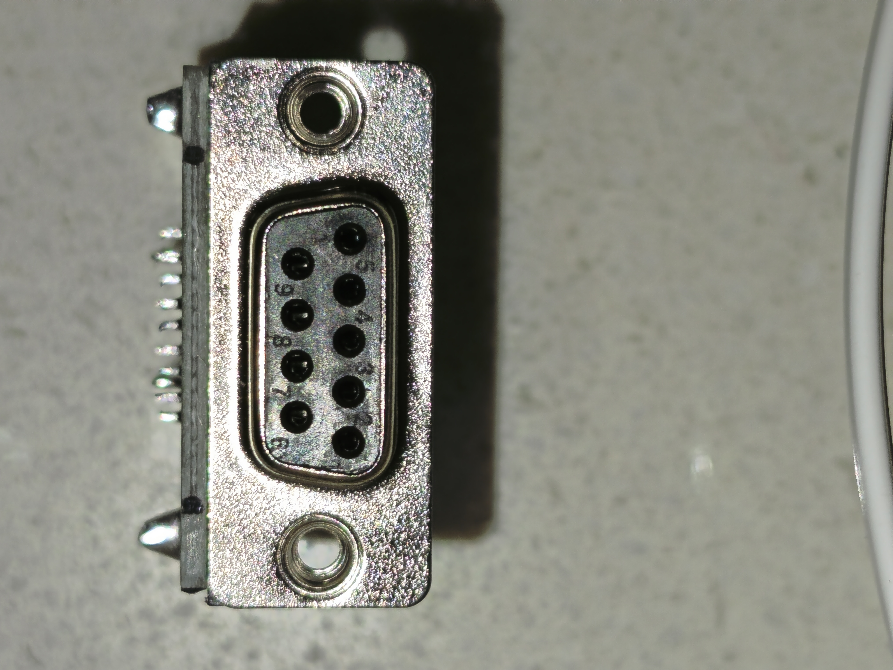
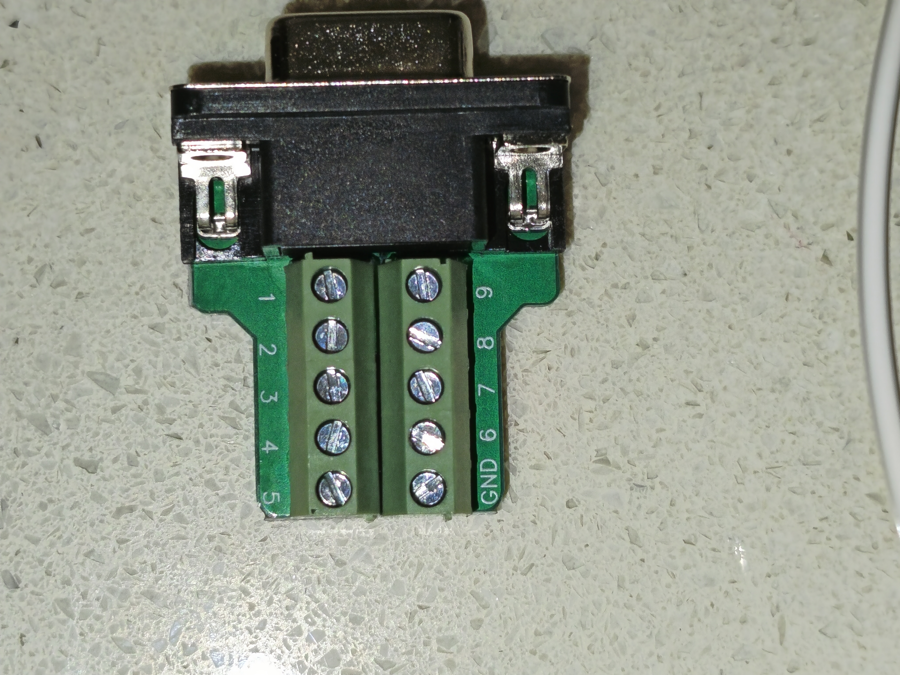

# MEAN WELL NTU-1200 Remote Port (RJ11) 對接 DB9 螺絲端子台實體接線圖解指南

本手冊依據現場實拍之原廠硬體、DB9 螺絲端子台與實體四芯電話線（本目錄內寫真相片），提供 100% 精確之實物對接圖解與施工指引。

---

## 📷 一、 實物照片與硬體對照

本目錄收錄現場實物拍攝相片如下：

### 1. NTU-1200-112US 機身 Remote Port 實機插座

  

- **插座規格**：標準 RJ11 6P 母座（卡榫凹槽在上方，內部 6 根鍍金接腳在下方）。
- **實體標示腳位（由左至右 1 ~ 6）**：
  - **Pin 1**：NC（空腳）
  - **Pin 2**：**Rx**（逆變器指令接收端，接主機 TXD）
  - **Pin 3**：**GND**（逆變器內部通訊信號地）
  - **Pin 4**：**Tx**（逆變器遙測發送端，接主機 RXD）
  - **Pin 5**：NC（空腳）
  - **Pin 6**：NC（空腳）

---

### 2. DB9 母頭免焊接線端子台 (DB9 Breakout Terminal)

  
  &nbsp;&nbsp;&nbsp;&nbsp;
  

- **端子規格**：標準 DB9 母座（Female 帶 9 孔），對接 USB 轉 RS-232 轉接器（如 MOXA UPort 1110、UNITEK、Waveshare 隔離版）或 MOXA TCC-82 光電隔離器的 DB9 公針。
- **背面綠色螺絲端子排標號**：
  - **左側排**：`1`, `2`, `3`, `4`, `5`
  - **右側排**：`9`, `8`, `7`, `6`, `GND`

---

### 3. 四芯電話線 (6P4C) 實物線色與線芯排列

  

- **水晶頭正面俯視（金屬彈片朝上、面向自己；尾部卡榫朝下）**：
  - **槽位 1（最左外側）**：空槽（無金屬片、無線芯）
  - **槽位 2**：**棕色線 (Brown)**
  - **槽位 3**：**藍色線 (Blue)**
  - **槽位 4**：**橘色線 (Orange)**
  - **槽位 5**：**綠色線 (Green)**
  - **槽位 6（最右外側）**：空槽（無金屬片、無線芯）

---

## 🔌 二、 實體接線對照表 (保證 100% 正確)

將四芯電話線另一端剝皮後，請依照下表將各色線芯鎖入 DB9 綠色端子台對應螺絲孔：

| 水晶頭槽位 | 實體線色 | NTU-1200 訊號 | 鎖入 DB9 端子台孔位 | DB9 訊號名稱 | 訊號物理流向說明 | 實作施工處置 |
| :---: | :---: | :---: | :---: | :---: | :--- | :--- |
| **槽位 1** | *(空槽)* | NC 空腳 | — | — | 6P4C 塑膠空槽 | 無線 |
| **槽位 2** | **棕色 (Brown)** | **Rx** (逆變器接收) | **`3` 號孔** | **TXD** (主機發送) | 電腦/手機發出 `Q\r` 等指令 ──► 棕色線 ──► 逆變器 Rx 接收 | **鎖入端子台 3 號孔** |
| **槽位 3** | **藍色 (Blue)** | **GND** (通訊信號地) | **`5` 號孔** | **GND** (通訊地) | 雙端共用通訊地電位（經光耦隔離保護） | **鎖入端子台 5 號孔** |
| **槽位 4** | **橘色 (Orange)** | **Tx** (逆變器發送) | **`2` 號孔** | **RXD** (主機接收) | 逆變器回傳 `(110.0 ...)` 遙測數據 ──► 橘色線 ──► 主機 RXD 接收 | **鎖入端子台 2 號孔** |
| **槽位 5** | **綠色 (Green)** | **NC** (空腳無作用) | **⚠️ 不接** | — | 逆變器內部空腳，無任何通訊功能 | **剪平絕緣，不可鎖入任何端子孔** |
| **槽位 6** | *(空槽)* | NC 空腳 | — | — | 6P4C 塑膠空槽 | 無線 |
| *(其餘孔位)* | — | — | **`1, 4, 6, 7, 8, 9, GND`** | — | RS-232 握手/保留線，本機通訊無須使用 | **全部保持懸空不鎖線** |

---

## 💡 三、 現場快速記憶口訣

> - **橘鎖 2（RXD 接 Tx）**：橘色接收逆變器回傳數據，鎖入 **2** 號孔。
> - **棕鎖 3（TXD 接 Rx）**：棕色發送控制指令給逆變器，鎖入 **3** 號孔。
> - **藍鎖 5（GND 接地）**：藍色通訊信號地線，鎖入 **5** 號孔。
> - **綠色剪斷包絕緣**：綠色線懸空不接，絕不誤入任何孔位！

---

## 🛠️ 四、 上電前「電錶量測三重防呆驗收」

接線完成後，在插入電腦或逆變器前，請務必使用三用電錶完成以下檢驗：

1. **導通性檢查（電錶蜂鳴檔）**：
   - 紅黑表筆點測【DB9 端子 2 號孔】與【RJ11 水晶頭 Pin 4（橘線槽）】 ➔ **必須長鳴（導通，阻值 < 1Ω）**。
   - 紅黑表筆點測【DB9 端子 3 號孔】與【RJ11 水晶頭 Pin 2（棕線槽）】 ➔ **必須長鳴（導通，阻值 < 1Ω）**。
   - 紅黑表筆點測【DB9 端子 5 號孔】與【RJ11 水晶頭 Pin 3（藍線槽）】 ➔ **必須長鳴（導通，阻值 < 1Ω）**。

2. **短路絕緣檢查（電錶高阻檔 200kΩ / 2MΩ）**：
   - 量測端子台 **2 號與 3 號** 之間 ➔ 必須為 **無限大開路（OL）**。
   - 量測端子台 **2 號與 5 號** 之間 ➔ 必須為 **無限大開路（OL）**。
   - 量測端子台 **3 號與 5 號** 之間 ➔ 必須為 **無限大開路（OL）**。
   *(若有任何數值，表示線芯毛邊搭接短路，必須重新修剪端子線頭！)*

3. **安全上電實測**：
   - RJ11 水晶頭插入 NTU-1200 Remote Port，逆變器開啟電源。
   - DB9 端暫不接電腦，電錶直流電壓檔量測：
     - 黑表筆接【端子 5 號孔 (GND)】，紅表筆量【端子 2 號孔 (橘線/逆變器 Tx)】。
     - 正常情況下應測得 **約 -5V 至 -10V 的負電壓**（RS-232 待機標記 MARK 狀態），證實 NTU-1200 晶片正常發報待命。
   - 確認負電壓正常後，即可放心將 DB9 母頭插上隔離轉換器，開啟 Web HMI 或 PC 桌面中心開始監控！
