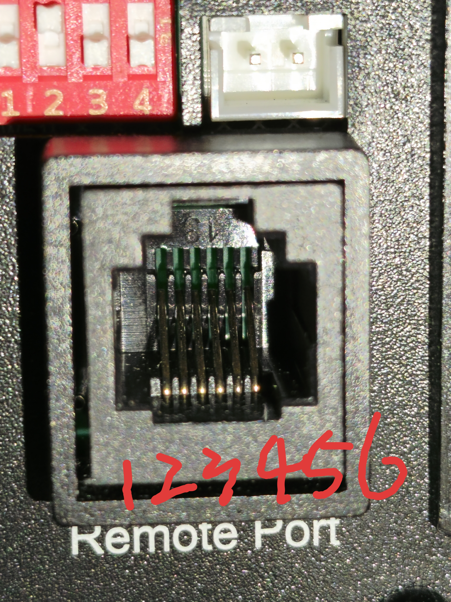

# MEAN WELL NTU-1200 Remote Port (RJ11) 對接 DB9 螺絲端子台實體接線圖解指南

本手冊依據現場實拍之原廠硬體、DB9 螺絲端子台與實體四芯電話線（本目錄內寫真相片），提供 100% 精確之實物對接圖解與施工指引。

---

## 📷 一、 實物照片與硬體對照

本目錄收錄現場實物拍攝相片如下：

### 1. NTU-1200-112US 機身 Remote Port 實機插座
<p align="center">
  
</p>

- **插座規格**：標準 RJ11 6P 母座（卡榫凹槽在上方，內部 6 根金屬彈針在下方）。
- **實體標示腳位（正視插座，由左至右 1 ~ 6）**：
  - **Pin 1**：NC（空腳）
  - **Pin 2**：**Rx**（逆變器指令接收端，接主機 TXD）
  - **Pin 3**：**GND**（逆變器內部通訊信號地）
  - **Pin 4**：**Tx**（逆變器遙測發送端，接主機 RXD）
  - **Pin 5**：NC（空腳）
  - **Pin 6**：NC（空腳）

---

### 2. DB9 母頭免焊接線端子台 (DB9 Breakout Terminal)
<p align="center">
  
  &nbsp;&nbsp;&nbsp;&nbsp;
  
</p>

- **端子規格**：標準 DB9 母座（Female 帶 9 孔），對接 USB 轉 RS-232 轉接器（如 MOXA UPort 1110、UNITEK、Waveshare 隔離版）或 MOXA TCC-82 光電隔離器的 DB9 公針。
- **背面綠色螺絲端子排標號**：
  - **左側排**：`1`, `2`, `3`, `4`, `5`
  - **右側排**：`9`, `8`, `7`, `6`, `GND`

---

### 3. 四芯電話線 (6P4C) 實物線色與線芯排列
<p align="center">
  
</p>

- **水晶頭正面俯視（金屬彈片朝上、面向自己；尾部卡榫朝下）**：
  - **槽位 1（最左外側）**：空槽（無金屬片、無線芯）
  - **槽位 2**：**棕色線 (Brown)**
  - **槽位 3**：**藍色線 (Blue)**
  - **槽位 4**：**橘色線 (Orange)**
  - **槽位 5**：**綠色線 (Green)**
  - **槽位 6（最右外側）**：空槽（無金屬片、無線芯）

---

## 🌟 二、 水晶頭「卡榫彈片朝上」真實插入姿態示意圖 (1:1 實物匹配對照)

> [!IMPORTANT]
> **【卡榫彈片朝上】真實插入姿態核心定義**：
> 當手持 RJ11 水晶頭準備插入 NTU-1200 逆變器 Remote Port 插座時：
> - **空間姿態**：塑膠**卡榫彈片朝上**（天花板方向）、底部**黃銅接觸面朝下**（地面方向）、線材尾部朝向自己、水晶頭透明前端伸向逆變器機身。
> - **逆變器母座**：上方為卡榫固定槽，下方為 6 根金屬彈針（由左至右 1 ~ 6 號）。
> - **槽位對照**：此姿態下，由左至右看進去各槽位與機身針腳 **100% 精確吻合**，完全無左右鏡像顛倒問題！

```
====================================================================================================
           【卡榫彈片朝上 (Latch UP) 插入姿態】6P4C 水晶頭與 NTU-1200 母座 1:1 匹配圖
====================================================================================================

      視線方向：線身在後（朝向操作者），水晶頭前端向前（伸入逆變器插座）

                             ▲ 頂部：塑膠卡榫彈片朝上 (Latch Tab UP)
                             │
                      ┌──────┴──────┐
                      │ ┌─────────┐ │
                      │ │ 卡榫彈片│ │
       ┌──────────────┴─┴─────────┴─┴──────────────┐
       │                                           │  <── 6P4C 透明水晶頭本體
       │  [ 1 ]    [ 2 ]    [ 3 ]    [ 4 ]    [ 5 ]    [ 6 ]  │  <── 水晶頭 6 個槽位 (由左至右)
       └───┬────────┬────────┬────────┬────────┬────────┬───┘
           │        │        │        │        │        │
         (空槽)   【棕色】 【藍色】 【橘色】 【綠色】  (空槽)
           │        │        │        │        │        │
           │      ▼ 底部：黃銅接觸面朝下 (Contacts DOWN) ▼
           │        │        │        │        │        │
   ════════╪════════╪════════╪════════╪════════╪════════╪═════════════════════════════════════════
           │ (直接對準插入逆變器 Remote Port 機身母座)
           ▼        ▼        ▼        ▼        ▼        ▼
       [ Pin 1 ] [ Pin 2 ] [ Pin 3 ] [ Pin 4 ] [ Pin 5 ] [ Pin 6 ]  <── 機身母座 6 根金屬彈針 (位於底部)
          NC       **Rx**    **GND**   **Tx**     NC       NC
        (空腳)   (逆變器收)  (信號地) (逆變器發) (空腳)   (空腳)
                    │        │        │        │
   ─────────────────┼────────┼────────┼────────┼──────────────────────────────────────────
                    │        │        │        └───────► ⚠️ 剪平絕緣，懸空不接任何端子孔
                    │        │        │
                    ▼        ▼        ▼
               ┌───────────────────────────┐
               │ DB9 母頭 綠色螺絲端子台   │
               │                           │
               │ • 端子孔【3】 ◄── 棕色線  │  <── (主機發送 TXD ──► 逆變器接收 Rx)
               │ • 端子孔【5】 ◄── 藍色線  │  <── (共用通訊信號地 GND)
               │ • 端子孔【2】 ◄── 橘色線  │  <── (逆變器發送 Tx ──► 主機接收 RXD)
               └───────────────────────────┘
====================================================================================================
```

---

## 🔌 三、 實體接線對照表 (保證 100% 正確)

將四芯電話線另一端剝皮後，請依照下表將各色線芯鎖入 DB9 綠色端子台對應螺絲孔：

| 水晶頭槽位 | 卡榫朝上時位置 | 實體線色 | NTU-1200 訊號 | 鎖入 DB9 端子台孔位 | DB9 訊號名稱 | 訊號物理流向說明 | 實作施工處置 |
| :---: | :---: | :---: | :---: | :---: | :---: | :--- | :--- |
| **槽位 1** | 最左外側 | *(空槽)* | NC 空腳 | — | — | 6P4C 塑膠空槽 | 無線芯 |
| **槽位 2** | 左起第 2 槽 | **棕色 (Brown)** | **Rx** (逆變器接收) | **`3` 號孔** | **TXD** (主機發送) | 電腦/手機發出 `Q\r` 等指令 ──► 棕色線 ──► 逆變器 Rx 接收 | **鎖入端子台 3 號孔** |
| **槽位 3** | 左起第 3 槽 | **藍色 (Blue)** | **GND** (通訊信號地) | **`5` 號孔** | **GND** (通訊地) | 雙端共用通訊地電位（經光耦隔離保護） | **鎖入端子台 5 號孔** |
| **槽位 4** | 左起第 4 槽 | **橘色 (Orange)** | **Tx** (逆變器發送) | **`2` 號孔** | **RXD** (主機接收) | 逆變器回傳 `(110.0 ...)` 遙測數據 ──► 橘色線 ──► 主機 RXD 接收 | **鎖入端子台 2 號孔** |
| **槽位 5** | 左起第 5 槽 | **綠色 (Green)** | **NC** (空腳無作用) | **⚠️ 不接** | — | 逆變器內部空腳，無任何通訊功能 | **剪平絕緣，不可鎖入任何端子孔** |
| **槽位 6** | 最右外側 | *(空槽)* | NC 空腳 | — | — | 6P4C 塑膠空槽 | 無線芯 |
| *(其餘孔位)* | — | — | — | **`1, 4, 6, 7, 8, 9, GND`** | — | RS-232 握手/保留線，本機通訊無須使用 | **全部保持懸空不鎖線** |

---

## 💡 四、 現場快速記憶口訣

> - **卡榫朝上、金針朝下**：由左至右分別為 空、棕(Rx)、藍(GND)、橘(Tx)、綠(NC)、空。
> - **橘鎖 2（RXD 接 Tx）**：橘色接收逆變器回傳數據，鎖入 **2** 號孔。
> - **棕鎖 3（TXD 接 Rx）**：棕色發送控制指令給逆變器，鎖入 **3** 號孔。
> - **藍鎖 5（GND 接地）**：藍色通訊信號地線，鎖入 **5** 號孔。
> - **綠色剪斷包絕緣**：綠色線懸空不接，絕不誤入任何孔位！

---

## 🛠️ 五、 上電前「電錶量測三重防呆驗收」

接線完成後，在插入電腦或逆變器前，請務必使用三用電錶完成以下檢驗：

### 1. 導通性檢查（電錶蜂鳴檔 / 歐姆檔）
- 紅黑表筆點測【DB9 端子 2 號孔】與【RJ11 水晶頭 Pin 4（橘線槽）】 ➔ **必須長鳴（導通，阻值約 1.0Ω ~ 1.1Ω）**。
- 紅黑表筆點測【DB9 端子 3 號孔】與【RJ11 水晶頭 Pin 2（棕線槽）】 ➔ **必須長鳴（導通，阻值約 1.0Ω ~ 1.1Ω）**。
- 紅黑表筆點測【DB9 端子 5 號孔】與【RJ11 水晶頭 Pin 3（藍線槽）】 ➔ **必須長鳴（導通，阻值約 1.0Ω ~ 1.1Ω）**。

> [!TIP]
> **常見實測疑問：量測數值在 1.04Ω、1.06Ω 或 1.1Ω 跳動，這樣算正常嗎？**
> 
> **答：完全正常！這代表該線路「極佳導通 (PASS)」！**
> - **原因解析**：
>   1. **表筆引線電阻**：數位萬用電錶紅黑探棒本身的引線與內部插孔接觸電阻，通常就有約 `0.2Ω ~ 0.4Ω`。
>   2. **細銅線直流電阻**：1~2 公尺長的四芯扁平電話細銅線（AWG 28/26），其單芯直流迴路電阻約為 `0.3Ω ~ 0.5Ω`。
>   3. **接觸面電阻**：探棒筆尖與水晶頭鍍金針片刺破接點、以及 DB9 端子台螺絲金屬片夾緊處之接觸電阻約為 `0.2Ω ~ 0.4Ω`。
>   4. **總阻抗總和**：上述三者相加，總迴路阻抗落在 **`1.04Ω ~ 1.10Ω`** 之間微幅跳動，屬於非常健康、標準的低阻抗金屬通路！
> - 若是線路斷路、未壓合或虛接，電錶會顯示 **`0.L`**、**`OL`** 或 **`1`**（無窮大 / 超量程）。
> - 因此，只要有蜂鳴長鳴且阻值在 1Ω 左右，就代表壓線與端子鎖固完全成功！

### 2. 短路絕緣檢查（電錶高阻檔 200kΩ / 2MΩ 或蜂鳴檔）
- 量測端子台 **2 號與 3 號** 之間 ➔ 必須為 **無限大開路（OL）**，電錶絕不可響。
- 量測端子台 **2 號與 5 號** 之間 ➔ 必須為 **無限大開路（OL）**，電錶絕不可響。
- 量測端子台 **3 號與 5 號** 之間 ➔ 必須為 **無限大開路（OL）**，電錶絕不可響。
*(若有任何數值或發出蜂鳴聲，代表線芯銅絲毛邊搭接造成相鄰短路，必須鬆開螺絲重新修整線頭！)*

### 3. 安全上電實測
- RJ11 水晶頭插入 NTU-1200 Remote Port，逆變器開啟電源開關。
- DB9 端暫不接電腦，電錶切換至直流電壓檔 (DCV 20V 檔位) 量測：
  - 黑表筆接【端子 5 號孔 (GND)】，紅表筆量【端子 2 號孔 (橘線/逆變器 Tx)】。
  - 正常情況下應測得 **約 -5V 至 -10V 的負電壓**（RS-232 待機標記 MARK 狀態），證實 NTU-1200 通訊晶片正常發報待命。
- 確認負電壓正常後，即可放心將 DB9 母頭插上隔離轉換器，開啟 Web HMI 或 PC 桌面中心開始監控！
