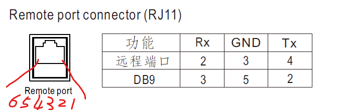

# MEAN WELL NTU-1200 Remote Port (RJ11) 對接 DB9 螺絲端子台實體接線圖解指南

> **核定依據與圖面事實基準**：
> 1. 明緯原廠規格書第 6 頁《Remote port connector (RJ11) 腳位定義圖解》
> 2. 機身實體 Remote Port 母座刻字（正視由左至右為 `6 5 4 3 2 1`）
> 3. 現場四芯電話線水晶頭實體線芯排列（卡榫朝上時，由左至右為 `空、棕、藍、橘、綠、空`）

---

## 📷 一、 原廠圖紙與實物相片核定

### 1. 原廠規格書 Remote Port (RJ11) 腳位定義圖解
<p align="center">
  
</p>

- **原廠插座視角（卡榫凹槽朝上，內部金屬針在下方）**：
  - 由左至右實體排列順序：**`Pin 6`、`Pin 5`、`Pin 4`、`Pin 3`、`Pin 2`、`Pin 1`**（左側為 6 號，右側為 1 號）。
- **原廠功能對照表**：

| 訊號名稱 (功能) | 逆變器 Remote Port 實體腳位 | 對接 DB9 端子台孔位 | 物理訊號傳輸意義 |
| :---: | :---: | :---: | :--- |
| **Rx (逆變器接收)** | **Pin 2** (右起第 2 針) | **`3` 號孔 (TXD)** | 電腦發送控制指令 ──► 逆變器 Rx 接收 |
| **GND (信號地)** | **Pin 3** (右起第 3 針) | **`5` 號孔 (GND)** | 雙端共用通訊信號地電位 |
| **Tx (逆變器發送)** | **Pin 4** (左起第 3 針 / 右起第 4 針) | **`2` 號孔 (RXD)** | 逆變器回傳遙測封包 ──► 電腦 RXD 接收 |
| **NC (空腳)** | **Pin 1, 5, 6** | *(不接 / 懸空)* | 逆變器內部空腳，無任何通訊功能 |

---

### 2. 四芯電話線 (6P4C) 水晶頭線色與機身插座 1:1 精確對照
<p align="center">
  
</p>

#### ① 水晶頭插入姿態（卡榫彈片朝上 Latch UP，黃銅接觸片朝下 Contacts DOWN）：
當手持水晶頭、**卡榫彈片朝上**插入 NTU-1200 機身插座時，由線身朝向操作者、透明水晶頭前端伸入逆變器插座看進去：
**實體線色排列由左至右為：`空槽`、`棕色`、`藍色`、`橘色`、`綠色`、`空槽`**！

```
====================================================================================================
           【卡榫彈片朝上 (Latch UP) 插入姿態】6P4C 水晶頭與 NTU-1200 母座 1:1 匹配圖
====================================================================================================

      視線方向：線身在後（朝向操作者），水晶頭前端向前（伸入逆變器插座）

                             ▲ 頂部：塑膠卡榫彈片朝上 (Latch Tab UP)
                             │
                      ┌──────┴──────┐
                      │ ┌─────────┐ │
                      │ │ 卡榫彈片│ │
       ┌──────────────┴─┴─────────┴─┴──────────────┐
       │                                           │  <── 6P4C 透明水晶頭本體
       │  [ 6 ]    [ 5 ]    [ 4 ]    [ 3 ]    [ 2 ]    [ 1 ]  │  <── 槽位與針腳 (由左至右 6 到 1)
       └───┬────────┬────────┬────────┬────────┬────────┬───┘
           │        │        │        │        │        │
         (空槽)   【棕色】 【藍色】 【橘色】 【綠色】  (空槽)
           │        │        │        │        │        │
           │      ▼ 底部：黃銅接觸面朝下 (Contacts DOWN) ▼
           │        │        │        │        │        │
   ════════╪════════╪════════╪════════╪════════╪════════╪═════════════════════════════════════════
           │ (直接對準插入逆變器 Remote Port 機身母座)
           ▼        ▼        ▼        ▼        ▼        ▼
       [ Pin 6 ] [ Pin 5 ] [ Pin 4 ] [ Pin 3 ] [ Pin 2 ] [ Pin 1 ]  <── 機身母座針腳 (由左至右 6 到 1)
          NC        NC       **Tx**    **GND**   **Rx**     NC
        (空腳)    (空腳)   (逆變器發)  (信號地) (逆變器收) (空腳)
                    │        │        │        │
   ─────────────────┼────────┼────────┼────────┼──────────────────────────────────────────
                    │        │        │        │
                    │        ▼        ▼        ▼
                    │   ┌───────────────────────────┐
                    │   │ DB9 母頭 綠色螺絲端子台   │
                    │   │                           │
                    │   │ • 端子孔【2】 ◄── 藍色線  │  <── (逆變器 Tx ──► 電腦端 RXD 接收)
                    │   │ • 端子孔【5】 ◄── 橘色線  │  <── (共用通訊信號地 GND)
                    │   │ • 端子孔【3】 ◄── 綠色線  │  <── (電腦端 TXD 發送 ──► 逆變器 Rx 接收)
                    │   └───────────────────────────┘
                    │
                    └───────► ⚠️ 棕色線為 Pin 5 (NC 空腳)：剪平包絕緣，嚴禁鎖入端子台任何孔位！
====================================================================================================
```

---

## 🔌 二、 實體接線最終正確鎖定表 (100% 符應實體線芯)

| 實體線色 | 插入時位置 | 逆變器訊號 | 鎖入 DB9 端子台孔位 | DB9 訊號名稱 | 訊號物理流向說明 | 施工動作 |
| :---: | :---: | :---: | :---: | :---: | :--- | :--- |
| **藍色 (Blue)** | 左起第 3 槽 (Pin 4) | **Tx (逆變器發送)** | **`2` 號孔** | **RXD (主機接收)** | 逆變器回傳數據 ──► 藍色線 ──► 主機 RXD | **鎖入端子台 2 號孔** |
| **橘色 (Orange)** | 左起第 4 槽 (Pin 3) | **GND (信號地)** | **`5` 號孔** | **GND (信號地)** | 雙端共用地電位基準 ──► 橘色線 ──► 主機 GND | **鎖入端子台 5 號孔** |
| **綠色 (Green)** | 左起第 5 槽 (Pin 2) | **Rx (逆變器接收)** | **`3` 號孔** | **TXD (主機發送)** | 主機發出指令 ──► 綠色線 ──► 逆變器 Rx | **鎖入端子台 3 號孔** |
| **棕色 (Brown)** | 左起第 2 槽 (Pin 5) | **NC (無作用)** | — | — | 逆變器內部空腳 (NC) | **剪平絕緣，嚴禁接線** |

---

## 🔍 三、 為什麼先前接線量出「-9.1V」與「0V」？真相完全大白！

先前接法為：`棕色接 3 號孔`、`橘色接 2 號孔`、`藍色接 5 號孔`。
對照實體針腳後，先前現象完全得到科學解釋：
1. **電腦端 3 號孔量到 -9.1V**：
   - 3 號孔是電腦 TXD，主動輸出 -9.1V RS-232 待命電壓。
   - 先前接了【棕色線】，而棕色線在插座裡連到 **Pin 5 (NC 空腳)**！
   - 電腦發送的指令送進了空氣空腳，所以逆變器完全收不到任何指令！
2. **電腦端 2 號孔量到 0V**：
   - 2 號孔是電腦 RXD，先前接了【橘色線】。
   - 而橘色線在插座裡真正連到的是 **Pin 3 (GND 信號地)**！
   - 電腦 RXD 接收端直接接地 (0V)，當然量出來恆為 **0V**！
3. **先前接法完全無燒毀疑慮**：
   - 電腦 TXD (-9.1V) 打入 NC 空腳（無迴路，電流為 0）。
   - 電腦 RXD 接地（純高阻抗，電流為 0）。
   - 逆變器 Tx (藍色線) 誤接到電腦 GND（RS-232 晶片具備連續對地短路保護，不傷晶片）。
