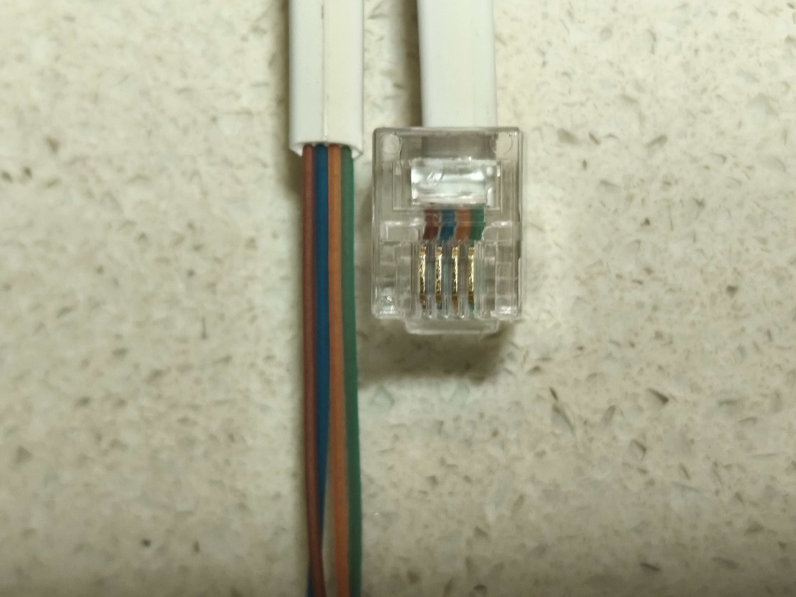

# MEAN WELL NTU-1200 Remote Port (RJ11) 對接 DB9 螺絲端子台實體接線圖解指南

> **核定依據與圖面事實基準**：
> 1. 明緯原廠規格書第 6 頁《Remote port connector (RJ11) 腳位定義圖解》
> 2. 實機 Remote Port 插座現場實拍與原廠鋼印刻字 (`6 5 4 3 2 1`)
> 3. 實體四芯電話線 (6P4C) 宏觀與微距顯微旋轉對照

---

## 📷 一、 原廠圖紙與實物相片核定

### 1. 原廠規格書 Remote Port (RJ11) 腳位定義圖解（現場人工覆核確定）
<p align="center">
  
</p>

- **原廠插座視角（卡榫凹槽朝上，內部金屬針在下方）**：
  - 由左至右實體排列順序：**`Pin 6`、`Pin 5`、`Pin 4`、`Pin 3`、`Pin 2`、`Pin 1`**（左側為 6 號，右側為 1 號）。
- **原廠功能對照表**：

| 訊號名稱 (功能) | 逆變器 Remote Port 實體腳位 | 對接 DB9 端子台孔位 | 物理訊號傳輸意義 |
| :---: | :---: | :---: | :--- |
| **Rx (逆變器接收)** | **Pin 2** (右起第 2 針) | **`3` 號孔 (TXD)** | 電腦發送控制指令 ──► 逆變器 Rx 接收 |
| **GND (信號地)** | **Pin 3** (右起第 3 針) | **`5` 號孔 (GND)** | 雙端共用通訊信號地電位 |
| **Tx (逆變器發送)** | **Pin 4** (左起第 3 針 / 右起第 4 針) | **`2` 號孔 (RXD)** | 逆變器回傳遙測封包 ──► 電腦 RXD 接收 |
| **NC (空腳)** | **Pin 1, 5, 6** | *(不接 / 懸空)* | 逆變器內部空腳，無任何通訊功能 |

---

### 2. 四芯電話線 (6P4C) 水晶頭線色與機身插座 1:1 精確對照
<p align="center">
  
</p>

#### ① 水晶頭插入姿態（卡榫彈片朝上 Latch UP，黃銅接觸片朝下 Contacts DOWN）：
當手持水晶頭、**卡榫彈片朝上**插入 NTU-1200 機身插座時，由透明水晶頭正視看進去，各槽位與線芯顏色排列如下：

```
====================================================================================================
           【卡榫彈片朝上 (Latch UP) 插入姿態】6P4C 水晶頭與 NTU-1200 母座 1:1 匹配圖
====================================================================================================

      視線方向：線身在後（朝向操作者），水晶頭前端向前（伸入逆變器插座）

                             ▲ 頂部：塑膠卡榫彈片朝上 (Latch Tab UP)
                             │
                      ┌──────┴──────┐
                      │ ┌─────────┐ │
                      │ │ 卡榫彈片│ │
       ┌──────────────┴─┴─────────┴─┴──────────────┐
       │                                           │  <── 6P4C 透明水晶頭本體
       │  [ 6 ]    [ 5 ]    [ 4 ]    [ 3 ]    [ 2 ]    [ 1 ]  │  <── 槽位與針腳 (由左至右 6 到 1)
       └───┬────────┬────────┬────────┬────────┬────────┬───┘
           │        │        │        │        │        │
         (空槽)   【綠色】 【橘色】 【藍色】 【棕色】  (空槽)
           │        │        │        │        │        │
           │      ▼ 底部：黃銅接觸面朝下 (Contacts DOWN) ▼
           │        │        │        │        │        │
   ════════╪════════╪════════╪════════╪════════╪════════╪═════════════════════════════════════════
           │ (直接對準插入逆變器 Remote Port 機身母座)
           ▼        ▼        ▼        ▼        ▼        ▼
       [ Pin 6 ] [ Pin 5 ] [ Pin 4 ] [ Pin 3 ] [ Pin 2 ] [ Pin 1 ]  <── 機身母座針腳 (由左至右 6 到 1)
          NC        NC       **Tx**    **GND**   **Rx**     NC
        (空腳)    (空腳)   (逆變器發)  (信號地) (逆變器收) (空腳)
                    │        │        │        │
   ─────────────────┼────────┼────────┼────────┼──────────────────────────────────────────
                    │        │        │        │
                    │        ▼        ▼        ▼
                    │   ┌───────────────────────────┐
                    │   │ DB9 母頭 綠色螺絲端子台   │
                    │   │                           │
                    │   │ • 端子孔【2】 ◄── 橘色線  │  <── (逆變器 Tx ──► 電腦端 RXD 接收)
                    │   │ • 端子孔【5】 ◄── 藍色線  │  <── (共用通訊信號地 GND)
                    │   │ • 端子孔【3】 ◄── 棕色線  │  <── (電腦端 TXD 發送 ──► 逆變器 Rx 接收)
                    │   └───────────────────────────┘
                    │
                    └───────► ⚠️ 綠色線為 NC 空腳：剪平包絕緣，嚴禁鎖入端子台任何孔位！
====================================================================================================
```

---

## 🔌 二、 實體接線鎖定清單 (標準正確接法)

| 實體線色 | 水晶頭槽位 | 逆變器訊號 | 鎖入 DB9 端子台孔位 | DB9 訊號名稱 | 訊號物理流向說明 | 施工動作 |
| :---: | :---: | :---: | :---: | :---: | :--- | :--- |
| **橘色 (Orange)** | 第 4 槽 (左起第 3 槽) | **Tx (逆變器發送)** | **`2` 號孔** | **RXD (主機接收)** | 逆變器回傳數據 ──► 橘色線 ──► 主機 RXD | **鎖入端子台 2 號孔** |
| **棕色 (Brown)** | 第 2 槽 (右起第 2 槽) | **Rx (逆變器接收)** | **`3` 號孔** | **TXD (主機發送)** | 主機發出指令 ──► 棕色線 ──► 逆變器 Rx | **鎖入端子台 3 號孔** |
| **藍色 (Blue)** | 第 3 槽 (中間靠右) | **GND (信號地)** | **`5` 號孔** | **GND (信號地)** | 雙端共用地電位基準 | **鎖入端子台 5 號孔** |
| **綠色 (Green)** | 第 5 槽 (左起第 2 槽) | **NC (無作用)** | — | — | 逆變器內部空腳 | **剪平絕緣，不可接線** |

---

## ⚡ 三、 實測電壓剖析：為什麼 3 號孔量到 -9.1V，而 2 號孔量到 0V？

使用者實測數據：
- `端子 3 號孔 (接棕色線)`：**-9.1V**
- `端子 2 號孔 (接橘色線)`：**0V**

### 1. 深度電氣原理剖析：
- **為什麼 3 號孔量到 -9.1V？**
  - DB9 的 3 號孔是**電腦端的發送端 (TXD)**。
  - 依據 EIA RS-232 國際標準，TXD 在閒置待命（IDLE / MARK 狀態）時，發送晶片會主動持續輸出 **-5V 至 -12V 的負電壓**。
  - **-9.1V 證實：電腦端 USB-RS232 轉接器供電與驅動完全正常！3 號孔確實為 TXD 發送端！**
- **為什麼 2 號孔量到 0V？**
  - DB9 的 2 號孔是**電腦端的接收端 (RXD)**。
  - RXD 是純高阻抗「輸入端」，電腦本身**絕對不會主動向 2 號孔輸出任何電壓**。
  - 2 號孔上的電壓，**必須完全依賴對端（NTU-1200 逆變器）的 Tx 腳位輸出**！
  - 如果量到 **0V**，物理上有兩種可能：
    - **可能一：逆變器尚未開機通電，或處於關斷狀態**（內部 RS-232 收發晶片未通電工作，Tx 腳位無電壓）。
    - **可能二：這條電話線的內部線芯顏色壓反了（線序鏡像顛倒）**，真正的 Inverter Tx 可能在綠色線或棕色線上。

---

## 🛠️ 四、 終極 10 秒抓出真 Tx 腳位量測 SOP（必勝檢驗法）

為徹底擺脫線色混淆，請依下列 3 步驟用三用電錶直接抓出 NTU-1200 的真實發送腳：

### 【步驟 1】：將電話線 4 條線與 DB9 端子台完全脫開
將 4 條裸線（棕、藍、橘、綠）從 DB9 綠色端子台鬆開，懸空在桌面上，彼此互不短路。

### 【步驟 2】：確認 NTU-1200 逆變器已「真正開機輸出」
1. 水晶頭牢固插入 NTU-1200 機身 Remote Port。
2. NTU-1200 前面板搖臂電源開關切至 **`ON`**。
3. 確保 12V 蓄電池已連接，且逆變器前面板綠色 **Inverter LED 恆亮**（AC 插座已有 110V 輸出）。
4. 檢查 Remote Port 上方的白色 2-Pin R.C. 端子：**必須保持開路（未插線或插頭開路）**。手冊規範：Pin 1,2 開路為正常工作，若短路會強制遙控關機！

### 【步驟 3】：用電錶量測 4 條線的真實直流電壓 (DC 20V 檔)
- **黑表筆** 固定夾在 **【藍色線 (GND)】** 上。
- **紅表筆** 依序點測其餘三條線：
  1. 點測 **【橘色線】** ➔ 電壓為多少？
  2. 點測 **【綠色線】** ➔ 電壓為多少？
  3. 點測 **【棕色線】** ➔ 電壓為多少？

#### 🎯 判定黃金準則：
> **「哪一條線相對於藍色線量到 -5V 至 -10V 的負電壓，那一條線就是 100% 真正的 Inverter Tx！」**
> 
> - **情況 A（標準線序）**：若【橘色線】量到 **-6V ~ -10V**，【綠色線】與【棕色線】為 0V：
>   - 證實：**橘色線就是 Tx！請將橘色線鎖回 DB9 端子台 2 號孔，棕色線鎖回 3 號孔，藍色線鎖回 5 號孔！**
> - **情況 B（線序鏡像反轉線）**：若【綠色線】量到 **-6V ~ -10V**，【橘色線】為 0V：
>   - 證實：電話線水晶頭線序顛倒，**綠色線才是 Tx！請將綠色線鎖入 DB9 端子台 2 號孔，橘色線剪平絕緣，棕色線鎖入 3 號孔！**
> - **情況 C（全反轉線）**：若【棕色線】量到 **-6V ~ -10V**：
>   - 證實：棕色線是 Tx，請將棕色線鎖入 2 號孔，橘色線鎖入 3 號孔！
> - **情況 D（三條線全為 0V）**：
>   - 證實：**NTU-1200 內部尚未對通訊晶片供電！請檢查機身開關、12V 電池電壓與 R.C. 遙控插座是否開路！**
